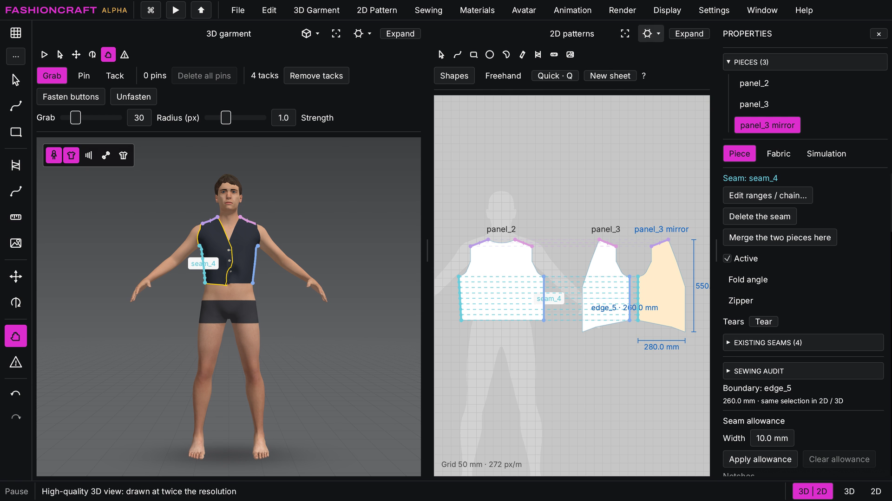
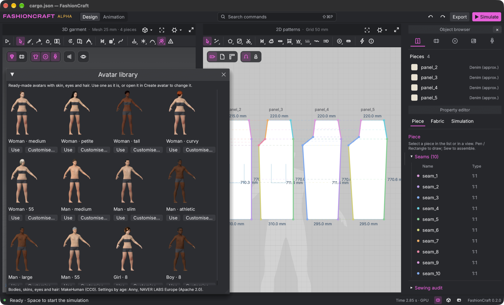

<p align="center">
  
</p>

<h1 align="center">FashionCraft</h1>

<p align="center">
  <strong>Open-source 3D garment design.</strong><br>
  Draw patterns in 2D, sew them, dress an avatar and watch the garment drape in 3D.
</p>

<p align="center">
  <a href="https://github.com/opopina/fashioncraft/releases/latest"></a>
  <a href="LICENSE"></a>
  <a href="https://github.com/opopina/fashioncraft/actions/workflows/cpu.yml"></a>
  
  
  <a href="https://appimage.github.io/FashionCraft/"></a>
</p>

<p align="center">
  <a href="https://github.com/opopina/fashioncraft/releases/download/v0.2.2/fashioncraft-0.2.2-windows-x64.msi"></a>
  &nbsp;
  <a href="https://github.com/opopina/fashioncraft/releases/download/v0.2.2/fashioncraft-0.2.2-macos-universal.dmg"></a>
  &nbsp;
  <a href="https://github.com/opopina/fashioncraft/releases/download/v0.2.2/fashioncraft-0.2.2-linux-x86_64.AppImage"></a>
</p>

<p align="center">
  <sub>Version 0.2.2 · Windows 10 and 11 (64-bit) · macOS 11 or newer, Apple silicon and Intel · Linux x86-64<br>
  <a href="#download">Other files and first-launch notes</a> · <a href="https://github.com/opopina/fashioncraft/releases">All releases</a></sub>
</p>

<p align="center">
  
</p>

> [!NOTE]
> **FashionCraft is an early alpha.** It already covers the whole path from pattern to draped
> garment, but expect rough edges, slow or restless simulation on dense garments and cases that
> still fail. Reports with a small example are very welcome in
> [Issues](https://github.com/opopina/fashioncraft/issues).

## Highlights

- **Pattern and drape in one window.** A 2D pattern board and a 3D view side by side, with cloth
  simulated on the GPU. The workflow follows desktop garment tools such as Marvelous Designer and
  CLO.
- **Works with your pattern CAD.** DXF-AAMA and DXF-ASTM in and out, grading with points of
  measure and `.rul` rule tables, and a 1:1 PDF print.
- **Avatars ready to dress.** Twelve ready-made bodies, a body generator from twenty measurements,
  and a 104-bone skeleton for poses and walks.
- **Exports for 3D pipelines.** OBJ, glTF/GLB, FBX, Alembic, USD/USDZ and point caches, fabric maps
  included in glTF, USD, OBJ and FBX, plus a photoreal GPU render.
- **An Assistant that uses the AI you already have.** Claude Code, Codex (ChatGPT), Gemini CLI or
  Antigravity with your own login, an API key, or a local model. Every step it takes can be undone.
- **Free and open.** MIT-licensed, on Windows, macOS and Linux, in English and Spanish.

## See it in action

<table>
  <tr>
    <td width="50%" valign="top">
      <a href="https://www.youtube.com/watch?v=ugbX1SzTV9I"></a>
      <p><strong>Cargo trousers, from scratch to the runway</strong> (47 s). A real 4 min 20 s
      session shown in 24 seconds: pieces drawn on the board, sewing, pockets with topstitching and
      buttons, denim, the simulation and a request to the Assistant. Then the same trousers walking,
      rendered in Blender Cycles. Also on
      <a href="https://www.tiktok.com/@ricoptech/video/7711128682286353682">TikTok</a>.</p>
    </td>
    <td width="50%" valign="top">
      <a href="https://www.youtube.com/watch?v=V25IB4gy7MY"></a>
      <p><strong>A vest in 2 minutes 33 seconds</strong>, in one take: an avatar from the library,
      the back and front drawn with the polygon tool, a mirrored front, sewing, simulation, wool in
      charcoal grey, and buttons fastened through their buttonholes.</p>
    </td>
  </tr>
</table>

The vest was recorded with the app's own demo mode (`FASHIONCRAFT_DEMO=vest`). Two more demos drive
the same interface: `FASHIONCRAFT_DEMO=outfit` (trousers drafted from the avatar's measurements and
an overshirt drawn by hand) and `FASHIONCRAFT_DEMO=cargo` (cargo trousers drawn piece by piece). A
demo sets the language and layout it needs in its own window and leaves your preferences as they
were.

## Download

The buttons above download version 0.2.2. Every file is in the
[latest release](https://github.com/opopina/fashioncraft/releases/latest):

| System | File | How to install |
|---|---|---|
| **Windows** 10 and 11 (64-bit) | [`fashioncraft-0.2.2-windows-x64.msi`](https://github.com/opopina/fashioncraft/releases/download/v0.2.2/fashioncraft-0.2.2-windows-x64.msi) | Run it. It installs for your user, needs no administrator, and adds FashionCraft to the Start menu; uninstall it from Settings › Apps. |
| | [`fashioncraft-0.2.2-windows-x64-portable.zip`](https://github.com/opopina/fashioncraft/releases/download/v0.2.2/fashioncraft-0.2.2-windows-x64-portable.zip) | No installation: unzip it anywhere and open `fashioncraft.exe`. |
| **macOS** 11 or newer (Apple silicon and Intel) | [`fashioncraft-0.2.2-macos-universal.dmg`](https://github.com/opopina/fashioncraft/releases/download/v0.2.2/fashioncraft-0.2.2-macos-universal.dmg) | Open it and drag FashionCraft to Applications. |
| **Linux** (x86-64) | [`fashioncraft-0.2.2-linux-x86_64.AppImage`](https://github.com/opopina/fashioncraft/releases/download/v0.2.2/fashioncraft-0.2.2-linux-x86_64.AppImage) | Make it executable (`chmod +x`) and run it; works on most distributions. Also listed in the [AppImage catalog](https://appimage.github.io/FashionCraft/). |
| | [`fashioncraft-0.2.2-linux-x86_64.tar.gz`](https://github.com/opopina/fashioncraft/releases/download/v0.2.2/fashioncraft-0.2.2-linux-x86_64.tar.gz) | Unpack it and run `bin/fashioncraft`. |

`SHA256SUMS.txt` in each release lets you check the files.

The builds are not signed yet, so the first launch shows a warning:

- **Windows:** "Windows protected your PC". Choose **More info › Run anyway**.
- **macOS:** the app is blocked. Open **System Settings › Privacy & Security** and choose
  **Open Anyway**.

On a computer without a graphics driver (a virtual machine, a remote desktop) FashionCraft draws in
software and simulates on the CPU: it works, but slowly.

## Quick start

1. Open FashionCraft. The Home screen offers a new empty project, templates (T-shirt, dress, skirt,
   trousers), **Open…** and your recent projects.
2. Pick a template, or draw your pieces on the 2D board.
3. Sew the pieces together with the sewing tools.
4. Press **Simulate** (Space) and watch the garment drape on the avatar.
5. Change fabrics and colours, then export the garment for 3D tools or the patterns as DXF-AAMA for
   your pattern CAD or cutter.

Or open **Window › Assistant** and ask, for example: *"Draft a denim skirt for this avatar, simulate
it and show me how it falls."*

## Features

The menus follow the usual garment-design layout: File, Edit, 3D Garment, 2D Pattern, Sewing,
Materials, Avatar, Animation, Render, Display, Settings and Window.

- **2D patterns:** polygons, rectangles, ellipses, arc sectors, spirals and freehand shapes;
  internal lines, shapes and darts; mirrored pieces, booleans, trace, cut and sew, slash and
  spread, merge and unfold; rulers, smart guides and grid snapping. T-shirt, skirt and trousers
  drafted from measurements. DXF-AAMA and DXF-ASTM import and export for pattern CAD, plotters
  and cutters; DXF and SVG import; and a 1:1 PDF print of the patterns.
- **Grading:** sizes and grade rules, points of measure with tolerances, a review that lays every
  size over the base, and the `.rul` rule table.
- **Sewing:** segment, free and M:N sewing, automatic sewing, easing, length checks, pleats, seams
  that break under load, and torn seams.
- **3D garment:** arrangement points on the body, fold arrangement, superimpose, re-drape and auto
  fit. Cloth simulation on the GPU, with friction, pins, freezing, strengthening and layers.
  Strain, stress and pressure maps; steam and puckering.
- **Fabrics and trims:** fabric presets with colour, normal, roughness, displacement, opacity and
  metalness maps; real fabrics measured from simple workshop tests; prints and logos on the pattern
  or on the 3D garment; buttons and buttonholes, zippers, piping, tape and topstitching; a UV
  editor.
- **Avatars:** a library of twelve ready-made bodies with skin, eyes and hair. A body generator from
  gender, age, build and twenty measurements, using MakeHuman's CC0 shapes with the settings of
  NAVER LABS Europe's [Anny](https://github.com/naver/anny), and Anny's 104-bone skeleton with
  hand-painted skin weights. Avatar import from OBJ, glTF, FBX, USD and Alembic, with an automatic
  skeleton; an avatar editor, tape and girth measures, poses and BVH motion.
- **Animation, render and export:** record takes on the GPU or the CPU, with the cloth following a
  walking body; a photoreal GPU path tracer with HDR light and depth of field; export OBJ,
  glTF/GLB, FBX, Alembic, USD/USDZ, PC2 and MDD point caches and OBJ sequences; capture video of
  the 3D view.
- **Workspace:** a dark desktop-studio interface: each view has a header and a tool band, display
  menus and the current tool's controls float over the view, and property rows carry info tips.
  English and Spanish, a command palette, Python scripting and project recovery.



## The Assistant and AI agents

Open **Window › Assistant** and ask for what you need. The Assistant sees the whole garment (every
piece, seam and fabric, and the avatar's measurements), works in the open project as you watch,
and checks its own work after simulating. Every edit goes through the same commands as the menus,
so Undo takes any step back.

It runs on the AI you already use:

- **Claude Code**, **Codex** (ChatGPT), **Gemini CLI** or **Antigravity**, with your own login;
- an **API key** for Claude, ChatGPT or Gemini, saved in the system keychain;
- or a **local model**.

You can attach pictures, PDFs, tables and DXF or SVG patterns.

MCP clients can drive FashionCraft too. Turn on **Settings › AI agents › Let AI agents use
FashionCraft** and copy the entry shown there into Claude Desktop, Claude Code, Cursor or another
MCP client. See [AI agents and the Assistant](docs/agents.md).

## File formats

| Data | Opens | Saves or exports |
|---|---|---|
| Project | FashionCraft project JSON (also ClothCraft's) | Project JSON with its `.assets` folder |
| 2D patterns | DXF-AAMA and DXF-ASTM (D6673) pieces; closed outlines from DXF (generic planar) and SVG | DXF-AAMA, DXF-ASTM (D6673), 1:1 PDF, SVG |
| Avatar | OBJ, glTF/GLB, FBX, USD, Alembic; BVH motion | glTF/GLB, FBX |
| Garment | — | OBJ + MTL, glTF/GLB, FBX, Alembic, USD/USDZ, PC2, MDD, OBJ sequence |

Marvelous Designer and CLO project files are not supported; exchange formats are. See the
[input/output contracts](docs/interoperability.md). DXF-AAMA/ASTM pieces carry their cut and sew
lines, notches, grain line, name, size and quantity, and units. A graded garment goes out in its
base size with its grade rules in a `.rul` file beside the DXF, and a DXF with its `.rul` comes in
graded ([grading](docs/grading.md)). Fold lines and drill holes are not carried yet. See
[what goes in and out](docs/dxf-aama-astm.md).

## Platform status

| Platform | Status |
|---|---|
| **macOS** | The main platform, tested on Apple silicon. |
| **Windows** | Tested on Windows 11 (x64): the installer and the full vest demo. |
| **Linux** | Tested on Arch (Hyprland, NVIDIA). The AppImage is started on a bare Ubuntu in CI before every release. |

**Physics:** the GPU simulation is the fast path, for takes too: when the body moves, the GPU finds
contacts again within each step, so a walking leg no longer passes through the trousers. Dense
garments can still keep moving or snag on the body (a sleeve on a spread thumb, for example), a
little cloth can still sink into a bending knee in a walk, and the CPU path is slow on fine meshes.
See [the contact model](docs/ogc.md).

## Build from source

With Rust stable installed, from the repository root:

```sh
cargo run --release --locked --bin fashioncraft
```

The 3D view needs a graphics adapter supported by [wgpu](https://wgpu.rs) (Metal, Vulkan or
DirectX 12). On Linux you also need the Wayland or X11 and Vulkan libraries and
`xdg-desktop-portal` for the file dialogs.

## Contributing

Issues with a small example, the steps you took and what you expected are the most useful
contribution. For code, run the checks before sending a change:

```sh
cargo fmt --all -- --check
cargo clippy --locked --all-targets -- -D warnings
cargo test --locked
```

See [CONTRIBUTING.md](CONTRIBUTING.md) and the [architecture notes](docs/architecture.md).

## Credits and license

FashionCraft is [MIT-licensed](LICENSE).

FashionCraft is made by Ricardo Rivadeneira with Claude Opus 5.5, Anthropic's AI model.

It started from [ClothCraft](https://github.com/erythrofr/ClothCraft) by erythrofr and the ClothCraft
contributors (MIT). Its physics engine, document model and first editor come from there, and their
copyright notice is kept in [LICENSE](LICENSE); [CONTRIBUTORS.md](CONTRIBUTORS.md) lists the people
involved. Some authoring and camera tools were adapted from FireflyTheReal / julienfoss's fork
([notes](docs/firefly-integration.md)).

The bundled bodies, skins, eyes, hair and skin weights are MakeHuman's CC0 assets; the body settings
and the compact skeleton follow NAVER LABS Europe's [Anny](https://github.com/naver/anny) (Apache
2.0). These, the fonts and other third-party material are listed in
[THIRD_PARTY_NOTICES.md](THIRD_PARTY_NOTICES.md). The icon is documented in the
[artwork record](assets/branding/README.md).

FashionCraft is not affiliated with CLO Virtual Fashion or Marvelous Designer; those names are
trademarks of their owners. Only public manuals informed the workflow
([references](docs/manual-study.md)); no proprietary code, files, icons or garments are included.
