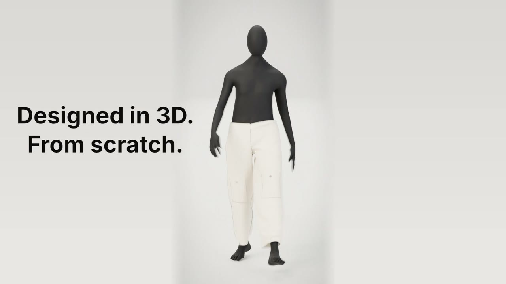

# FashionCraft

Open-source 3D garment design, written in Rust. Draw patterns in 2D, sew them, dress an avatar and
watch the garment drape in 3D, then take it to other 3D tools. The workflow follows desktop tools
like Marvelous Designer and CLO.


**FashionCraft is an early alpha.** It already covers the whole path from pattern to draped garment,
but expect rough edges, slow or restless simulation on dense garments and cases that still fail.
Reports with a small example are very welcome.

## See it

Cargo trousers from scratch, then on the runway (47 seconds). A real 4 min 20 s session in
FashionCraft (the pieces drawn on the board, sewing, cargo pockets with topstitching and buttons,
denim, the simulation and a request to the new AI Assistant) shown in 24 seconds; then the same
trousers walking, a Mixamo walk on FashionCraft's cloth solver, rendered in Blender Cycles.
Titles in EffectCraft, edit in FilmCraft.

[](https://www.youtube.com/watch?v=ugbX1SzTV9I)

On [YouTube](https://www.youtube.com/watch?v=ugbX1SzTV9I) and on TikTok: [@ricoptech](https://www.tiktok.com/@ricoptech/video/7711128682286353682).

A vest made from scratch in 2 minutes 33 seconds, in one take: an avatar from the library, the back
and front drawn with the polygon tool, a mirrored front, sewing, simulation, wool in charcoal grey,
and buttons fastened through their buttonholes. Recorded with the app's own demo mode
(`FASHIONCRAFT_DEMO=vest`), which also shows the tool rail at the left.
Two more demos drive the same interface: `FASHIONCRAFT_DEMO=outfit` (trousers drafted from the
avatar's measurements and an overshirt drawn by hand) and `FASHIONCRAFT_DEMO=cargo` (cargo trousers
drawn piece by piece, with pockets, topstitching and denim). A demo sets the language and layout
it needs in its own window and leaves your preferences as they were.

[](https://www.youtube.com/watch?v=V25IB4gy7MY)

## Download

Get the file for your system from the [latest release](https://github.com/opopina/fashioncraft/releases/latest):

| System | File | How to install |
|---|---|---|
| **Windows** 10 and 11 (64-bit) | `fashioncraft-<version>-windows-x64.msi` | Run it. It installs for your user, needs no administrator, and adds FashionCraft to the Start menu; uninstall it from Settings › Apps. |
| | `fashioncraft-<version>-windows-x64-portable.zip` | No installation: unzip it anywhere and open `fashioncraft.exe`. |
| **macOS** 11 or newer (Apple silicon and Intel) | `fashioncraft-<version>-macos-universal.dmg` | Open it and drag FashionCraft to Applications. |
| **Linux** (x86-64) | `fashioncraft-<version>-linux-x86_64.AppImage` | Make it executable (`chmod +x`) and run it; works on most distributions. |
| | `fashioncraft-<version>-linux-x86_64.tar.gz` | Unpack it and run `bin/fashioncraft`. |

`SHA256SUMS.txt` in each release lets you check the files.

The builds are not signed yet, so the first launch shows a warning:

- **Windows:** "Windows protected your PC". Choose **More info › Run anyway**.
- **macOS:** the app is blocked. Open **System Settings › Privacy & Security** and choose **Open Anyway**.

## Build from source

With Rust stable installed, from the repository root:

```sh
cargo run --release --locked --bin fashioncraft
```

The 3D view needs a graphics adapter supported by [wgpu](https://wgpu.rs) (Metal, Vulkan or
DirectX 12). On Linux you also need the Wayland or X11 and Vulkan libraries and
`xdg-desktop-portal` for the file dialogs.

## What it does

The menus follow the usual garment-design layout: File, Edit, 3D Garment, 2D Pattern, Sewing,
Materials, Avatar, Animation, Render, Display, Settings and Window.

- **2D patterns:** polygons, rectangles, ellipses, arc sectors, spirals and freehand shapes;
  internal lines, shapes and darts; mirrored pieces, booleans, trace, cut and sew, slash and
  spread, merge and unfold; rulers, smart guides and grid snapping. T-shirt, skirt and trousers
  drafted from measurements. DXF-AAMA and DXF-ASTM import and export for pattern CAD, plotters
  and cutters; DXF and SVG import; and a 1:1 PDF print of the patterns.
- **Sewing:** segment, free and M:N sewing, automatic sewing, easing, length checks, pleats and
  torn seams.
- **3D garment:** arrangement points on the body, fold arrangement, superimpose, re-drape and auto
  fit. Cloth simulation on the GPU, with friction, pins, freezing, strengthening and layers.
  Strain, stress and pressure maps; steam and puckering.
- **Fabrics and trims:** fabric presets with colour, normal and roughness textures; prints and logos
  on the pattern or on the 3D garment; buttons and buttonholes, zippers, piping, tape and
  topstitching.
- **Avatars:** a library of twelve ready-made bodies with skin, eyes and hair. A body generator from
  gender, age, build and twenty measurements, using MakeHuman's CC0 shapes with the settings of
  NAVER LABS Europe's [Anny](https://github.com/naver/anny), and Anny's 104-bone skeleton with
  hand-painted skin weights. Avatar import from OBJ, glTF, FBX, USD and Alembic, with an automatic
  skeleton; an avatar editor, tape and girth measures, poses and BVH motion.
- **Animation and export:** record takes on the GPU or the CPU, with the cloth following a walking
  body; export OBJ, glTF/GLB, FBX, Alembic, USD/USDZ, PC2 and MDD point caches and OBJ sequences;
  capture video of the 3D view.
- **Workspace:** a dark desktop-studio interface: each view has a header and a tool band, display
  menus and the current tool's controls float over the view, and property rows carry info tips.
  English and Spanish, a command palette, Python scripting and project recovery.
- **AI:** an Assistant chat (Window › Assistant) that drafts, dresses, simulates and checks
  garments for you with Claude, ChatGPT, Gemini or a local model, and an MCP server
  (`fashioncraft-cli mcp`) for Claude Desktop, Claude Code, Cursor and ArtCraft.


## AI agents

Ask the Assistant (**Window › Assistant**) for something like "Draft a denim skirt for this avatar,
simulate it and show me how it falls". It works in the open project as you watch, and Undo takes
any step back. Choose Claude, ChatGPT, Gemini or a local model under **Connection** and paste your
API key. The key is saved in the system keychain.

MCP clients can drive FashionCraft too. Turn on **Settings › AI agents › Let AI agents use
FashionCraft** and copy the entry shown there into Claude Desktop, Claude Code, Cursor or another
MCP client. See [AI agents and the Assistant](docs/agents.md).

## Files

| Data | Opens | Saves or exports |
|---|---|---|
| Project | FashionCraft project JSON (also ClothCraft's) | Project JSON with its `.assets` folder |
| 2D patterns | DXF-AAMA and DXF-ASTM (D6673) pieces; closed outlines from DXF (generic planar) and SVG | DXF-AAMA, DXF-ASTM (D6673), 1:1 PDF, SVG |
| Avatar | OBJ, glTF/GLB, FBX, USD, Alembic; BVH motion | glTF/GLB, FBX |
| Garment | — | OBJ + MTL, glTF/GLB, FBX, Alembic, USD/USDZ, PC2, MDD, OBJ sequence |

Marvelous Designer and CLO project files are not supported; exchange formats are. See the
[input/output contracts](docs/interoperability.md). DXF-AAMA/ASTM pieces carry:
- their cut and sew lines;
- notches;
- grain line;
- name, size and quantity;
- units.

A graded garment goes out in its base size with its grade rules in a `.rul` file beside the
DXF, and a DXF with its `.rul` comes in graded ([grading](docs/grading.md)). Fold lines and
drill holes are not carried yet. See [what goes in and out](docs/dxf-aama-astm.md).

## Status

- **macOS:** the main platform, tested on Apple silicon.
- **Linux:** being tested on Arch (Hyprland, NVIDIA).
- **Windows:** tested on Windows 11 (x64): the installer and the full vest demo.
- **Physics:** the GPU simulation is the fast path, for takes too: when the body moves, the GPU finds
  contacts again within each step, so a walking leg no longer passes through the trousers. Dense
  garments can still keep moving or snag on the body (a sleeve on a spread thumb, for example), a
  little cloth can still sink into a bending knee in a walk, and the CPU path is slow on fine
  meshes. See [the contact model](docs/ogc.md).

## Contributing

Issues with a small example, the steps you took and what you expected are the most useful
contribution. For code, run the checks before sending a change:

```sh
cargo fmt --all -- --check
cargo clippy --locked --all-targets -- -D warnings
cargo test --locked
```

See [CONTRIBUTING.md](CONTRIBUTING.md) and the [architecture notes](docs/architecture.md).

## License and credits

FashionCraft is [MIT-licensed](LICENSE).

FashionCraft is made by Ricardo Rivadeneira with Claude Opus 5.5, Anthropic's AI model.

It started from [ClothCraft](https://github.com/erythrofr/ClothCraft) by erythrofr and the ClothCraft
contributors (MIT). Its physics engine, document model and first editor come from there, and their
copyright notice is kept in [LICENSE](LICENSE); [CONTRIBUTORS.md](CONTRIBUTORS.md) lists the people
involved. Some authoring and camera tools were adapted from FireflyTheReal / julienfoss's fork
([notes](docs/firefly-integration.md)).

The bundled bodies, skins, eyes, hair and skin weights are MakeHuman's CC0 assets; the body settings
and the compact skeleton follow NAVER LABS Europe's [Anny](https://github.com/naver/anny) (Apache
2.0). These, the fonts and other third-party material are listed in
[THIRD_PARTY_NOTICES.md](THIRD_PARTY_NOTICES.md). The icon is documented in the
[artwork record](assets/branding/README.md).

FashionCraft is not affiliated with CLO Virtual Fashion or Marvelous Designer; those names are
trademarks of their owners. Only public manuals informed the workflow
([references](docs/manual-study.md)); no proprietary code, files, icons or garments are included.
