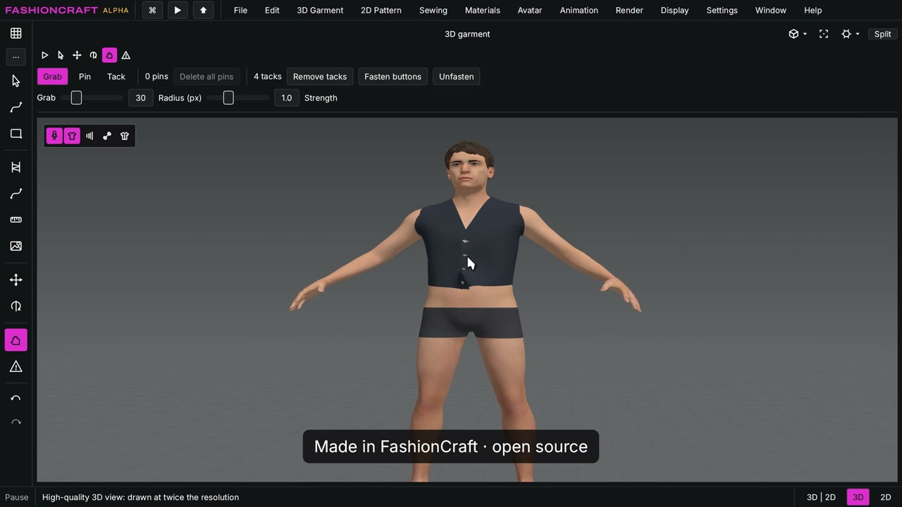

# FashionCraft

Open-source 3D garment design, written in Rust. Draw patterns in 2D, sew them, dress an avatar and
watch the garment drape in 3D, then take it to other 3D tools. The workflow follows desktop tools
like Marvelous Designer and CLO.


**FashionCraft is an early alpha.** It already covers the whole path from pattern to draped garment,
but expect rough edges, slow or restless simulation on dense garments and cases that still fail.
Reports with a small example are very welcome.

## See it

A vest made from scratch in 2 minutes 37 seconds: an avatar from the library, the back and front
drawn with the pen, a mirrored front, sewing, simulation, wool in charcoal grey, and buttons
fastened through their buttonholes. Recorded with the app's own demo mode (`FASHIONCRAFT_DEMO=vest`).

[](docs/media/vest-demo.mp4)

## Download

- **macOS (Apple silicon):** the `.dmg` in [Releases](https://github.com/opopina/fashioncraft/releases).
  The app is not notarised yet. The first time you open it, macOS will block it: allow it in
  System Settings › Privacy & Security › Open Anyway.
- **Linux and Windows:** builds are coming. Meanwhile, build from source.

## Build from source

With Rust stable installed, from the repository root:

```sh
cargo run --release --locked --bin fashioncraft
```

The 3D view needs a graphics adapter supported by [wgpu](https://wgpu.rs) (Metal, Vulkan or
DirectX 12). On Linux you also need the Wayland or X11 and Vulkan libraries and
`xdg-desktop-portal` for the file dialogs.

## What it does

The menus follow the usual garment-design layout: File, Edit, 3D Garment, 2D Pattern, Sewing,
Materials, Avatar, Animation, Render, Display, Settings and Window.

- **2D patterns:** polygons, rectangles, ellipses, arc sectors, spirals and freehand shapes;
  internal lines, shapes and darts; mirrored pieces, booleans, trace, cut and sew, slash and
  spread, merge and unfold; rulers, smart guides and grid snapping. T-shirt, skirt and trousers
  drafted from measurements. DXF and SVG import, and a 1:1 PDF print of the patterns.
- **Sewing:** segment, free and M:N sewing, automatic sewing, easing, length checks, pleats and
  torn seams.
- **3D garment:** arrangement points on the body, fold arrangement, superimpose, re-drape and auto
  fit. Cloth simulation on the GPU, with friction, pins, freezing, strengthening and layers.
  Strain, stress and pressure maps; steam and puckering.
- **Fabrics and trims:** fabric presets with colour, normal and roughness textures; prints and logos
  on the pattern or on the 3D garment; buttons and buttonholes, zippers, piping, tape and
  topstitching.
- **Avatars:** a library of twelve ready-made bodies with skin, eyes and hair. A body generator from
  gender, age, build and twenty measurements, using MakeHuman's CC0 shapes with the settings of
  NAVER LABS Europe's Anny. Avatar import from OBJ, glTF, FBX, USD and Alembic; an avatar editor,
  tape and girth measures, an automatic skeleton, poses and BVH motion.
- **Animation and export:** record takes; export OBJ, glTF/GLB, FBX, Alembic, USD/USDZ, PC2 and MDD
  point caches and OBJ sequences; capture video of the 3D view.
- **Workspace:** English and Spanish, a command palette, Python scripting and project recovery.


## Files

| Data | Opens | Saves or exports |
|---|---|---|
| Project | FashionCraft project JSON (also ClothCraft's) | Project JSON with its `.assets` folder |
| 2D patterns | Closed outlines from DXF (generic planar) and SVG | 1:1 PDF, SVG |
| Avatar | OBJ, glTF/GLB, FBX, USD, Alembic; BVH motion | glTF/GLB, FBX |
| Garment | — | OBJ + MTL, glTF/GLB, FBX, Alembic, USD/USDZ, PC2, MDD, OBJ sequence |

Marvelous Designer and CLO project files are not supported; exchange formats are. See the
[input/output contracts](docs/interoperability.md).

## Status

- **macOS:** the main platform, tested on Apple silicon.
- **Linux:** being tested on Arch (Hyprland, NVIDIA).
- **Windows:** not tested yet.
- **Physics:** the GPU simulation is the fast path. Dense garments can still keep moving or snag on the
  body (a sleeve on a spread thumb, for example), and the CPU path is slow on fine meshes. See
  [the contact model](docs/ogc.md).

## Contributing

Issues with a small example, the steps you took and what you expected are the most useful
contribution. For code, run the checks before sending a change:

```sh
cargo fmt --all -- --check
cargo clippy --locked --all-targets -- -D warnings
cargo test --locked
```

See [CONTRIBUTING.md](CONTRIBUTING.md) and the [architecture notes](docs/architecture.md).

## License and credits

FashionCraft is [MIT-licensed](LICENSE).

FashionCraft is made by Ricardo Rivadeneira with Claude Opus 5.5, Anthropic's AI model.

It started from [ClothCraft](https://github.com/erythrofr/ClothCraft) by erythrofr and the ClothCraft
contributors (MIT). Its physics engine, document model and first editor come from there, and their
copyright notice is kept in [LICENSE](LICENSE); [CONTRIBUTORS.md](CONTRIBUTORS.md) lists the people
involved. Some authoring and camera tools were adapted from FireflyTheReal / julienfoss's fork
([notes](docs/firefly-integration.md)).

The bundled bodies, skins, eyes and hair are MakeHuman's CC0 assets; the body settings follow
NAVER LABS Europe's Anny (Apache 2.0). These, the fonts and other third-party material are listed in
[THIRD_PARTY_NOTICES.md](THIRD_PARTY_NOTICES.md). The icon is documented in the
[artwork record](assets/branding/README.md).

FashionCraft is not affiliated with CLO Virtual Fashion or Marvelous Designer; those names are
trademarks of their owners. Only public manuals informed the workflow
([references](docs/manual-study.md)); no proprietary code, files, icons or garments are included.
