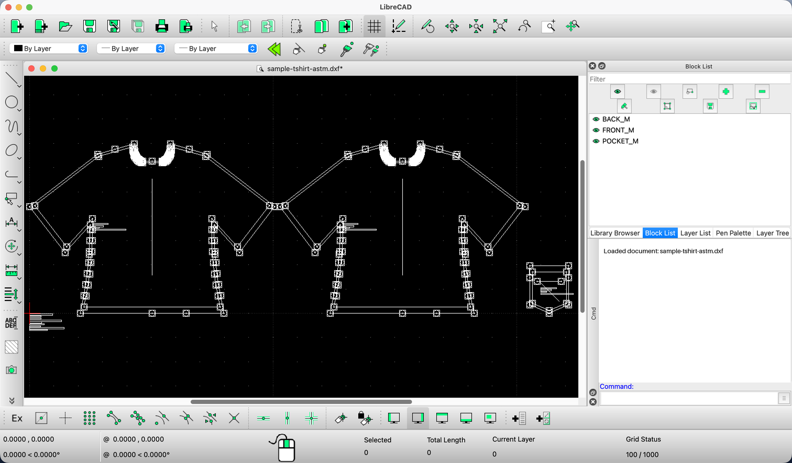
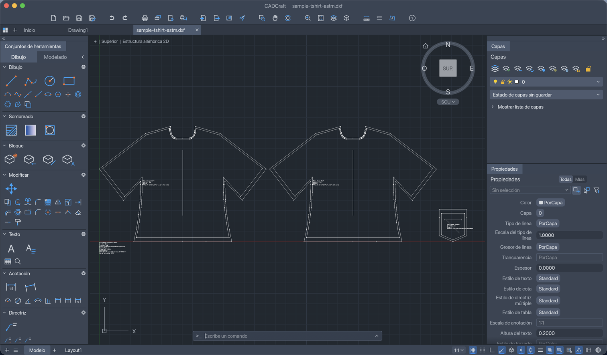

# DXF-AAMA and DXF-ASTM pattern exchange

Pattern CAD systems, plotters and cutting machines pass pieces to each other as DXF-AAMA and
DXF-ASTM (ASTM D6673) files. FashionCraft reads and writes both, so a workshop can take its
pieces into its own CAD, plot them or cut them, and bring pieces from that CAD into a garment.

- **Export:** File › Export › DXF-AAMA / ASTM patterns…, or
  `cloth-template dxf-export garment.json out.dxf --dialect astm --units mm --size M`.
- **Import:** File › Import › DXF-AAMA / ASTM patterns…. File › Import › DXF patterns… hands
  an apparel file to the same importer by itself. Or inspect a file without the app:
  `cloth-template dxf-inspect file.dxf`.

The format code is `src/garment/dxf_aama/` (`read.rs`, `write.rs`, and `template.rs` for
panels ↔ pieces). The dialogs are `src/atelier/dxf_aama_ui.rs`.

## What goes out

The file is an ASCII DXF release 12 (`AC1009`) drawing. Each panel becomes one BLOCK, placed
by an INSERT in a row. Inside each block:

| Layer | What | How |
|---|---|---|
| 1 | Cut line | Closed POLYLINE: the sewing outline grown by the stored seam allowances, or the outline itself when there are none |
| 14 | Sew line | Closed POLYLINE: the panel outline, written only when it differs from the cut line |
| 11 | Internal cutouts | Closed POLYLINE per hole (its cut line); its sew line goes on 14 when the hole has an allowance |
| 8 | Internal lines | POLYLINE, open or closed |
| 2 / 3 | Turn / curve points | A POINT on every point of the lines above: turn points on every outline point of the panel, curve points on the points sampled along its curves |
| 4 | Notches | A POINT on the cut line: Z (group 30) its depth, thickness (39) its opening (V notches only), angle (50) the direction it cuts into the piece, degrees counter-clockwise from +X |
| 7 | Grain line | LINE through the middle of the piece, 60 % of its extent along the grain, drawn in the warp's direction |
| 1 | Piece System Text | `Piece Name:`, `Quantity: R,L`, `Size:` and `Material:` (the fabric's name) |

Once in the drawing, on layer 1 below the pieces, the Style System Text: `Style Name:`,
`Creation Date:` (dd-mm-yyyy) and `Creation Time:` (hh:mm), both in UTC, `Author:`
(`FashionCraft;FashionCraft;<release>`), `Sample Size:`, `Grade Rule Table:` (empty),
`Units: METRIC` or `ENGLISH`, for ASTM `ASTM/D13 Proposal 1 Version: D 6673-04`, and
`Curve Tolerance:` (0.25 mm). Metric files are in millimetres with 2 decimals, English files in
inches with 4. The header also sets `$INSUNITS` and `$MEASUREMENT` for general CAD viewers.

All text is 7-bit ASCII: accented letters lose their accent (`Puño` → `Puno`), other characters
become `?`. Piece names are made unique (`Front`, `Front 2`). Curves are written as points no
farther than 0.25 mm from the curve, the same sampling as the 1:1 print.

The export dialog chooses the dialect (AAMA or ASTM), the units (metric or english), the size
label, the pieces (all, or the selected ones) and how many of each to cut as drawn and mirrored.

**AAMA and ASTM differ little in what FashionCraft writes.** ASTM files carry the ASTM version
line and declare the ASTM notch layers 80–83. FashionCraft has only slit and V notches, and both
go on layer 4 in either dialect. AAMA files carry no version line, because no public
description gives AAMA's own. A reader tells an AAMA file from an ASTM one by the missing
version line and the missing 80–87 layers.

## What comes in

The importer reads both dialects and lists everything it does not take before anything is
added. Each piece is shown with its name, size, quantity, material, size in mm, boundaries,
notches, grain and notes. The user picks the pieces, a fabric and a mesh spacing, and confirms
what stays out. The pieces then arrive as unsewn panels to the right of the avatar, in one undo
step.

**Read and kept:**
- One piece per block that has a closed cut line on layer 1. Boundaries drawn as separate
  LINE, ARC or POLYLINE segments are joined into a closed line.
- LINE, ARC, CIRCLE, POLYLINE (with bulges) and LWPOLYLINE.
- INSERT position, rotation, scale and mirroring.
- The sew line (14) becomes the panel outline, and the cut line (1) becomes its seam
  allowance. The allowance is measured per boundary: the median distance from the sew line's
  segments to the cut line, to 0.01 mm. Without a sew line, the cut line is the outline and
  there is no allowance.
- Boundaries split at the turn points that lie on the sew line. Without any, the sew line is
  split at its corners, where it turns more than 30°. A run of curve points becomes one cubic
  when one fits within 0.1 mm and keeps its length within 0.02 mm, and its straight segments
  otherwise.
- Notches written as points on layers 4 and 80–83, or as lines on layer 4. Each is followed
  inward onto the sew line and placed on its boundary by length. Its depth is kept. A notch on
  layer 4 with an opening is a V, otherwise a slit.
- The grain line (7), as an axis in [0°, 180°), to 0.01°.
- Internal lines (8) inside the piece, internal cutouts (11, with their own allowance when a sew
  line on 14 goes round them).
- `Piece Name`, `Quantity` (`n` or `R,L`), `Size` or `Size Name` (else the sample size),
  `Material` or `Category`; and `Style Name`, `Sample Size`, `Author` and `Units`.
- Keys are matched without regard to case or spacing.
- Units come from the `Units:` text, else `$INSUNITS`. With neither, the user types the
  millimetres per unit.
- The file may be UTF-8 or Windows-1252, and `\U+XXXX` escapes are decoded.

**Converted with a note:**
- T, castle, check and U notches come in as slits.
- Internal lines with more than 64 points are simplified, and the deviation is shown.
- A cut line that is not an even offset of the sew line (turned-back or squared corners) is
  reported with its largest gap.
- An allowance over 100 mm is left out.
- A notch too close to a boundary's end is left out.
- A notch without a depth gets 5 mm.

**Shown but not stored:** size, quantity and material. The garment has no place for them yet;
grading will add one.

**Not imported, and listed:**
- Mirror (fold) lines (6): the piece comes in as drawn, so a half piece stays a half.
- Grade reference lines (5), stripe and plaid lines (9, 10) and quality validation curves
  (84–87).
- Drill holes (13).
- Texts other than the keys above (`Rotation:`, `Flip:`, annotation on 15, and so on). Grade
  rule numbers and point marks (texts on layers 2–5, 13 and 80–83) are counted in one line.
- SPLINE, ELLIPSE, HATCH and other entities; entities on layers that are not numbered; entities
  outside a block; arrays of insertions.
- A block inserted more than once is imported once.
- Notches drawn as cuts into the boundary or as lines on layer 8 are not recognised as notches:
  they come in as outline shape or internal lines.
- Notches on an internal cutout's rim are listed as away from the cut line. Only the outer cut
  line takes notches on import, although the export writes them on cutouts too.
- Grading (`.RUL` files, graded nests) is not read. Each size block of a nest would come in as
  its own piece.
- Binary DXF and UTF-16 files are refused.

## Round trip

`tests/dxf_aama.rs` writes a sample garment and reads it back, in both dialects, in millimetres
and in inches. The garment is a T-shirt front and back with a scooped neckline, shaped sides,
allowances from 6 to 25 mm and slit and V notches, plus a bias-cut pocket with a placement line.
The tests check that:

- the same pieces come back, with their names, size, quantity and material;
- every boundary comes back as one boundary, its length within 0.1 mm;
- every allowance comes back within 0.02 mm;
- every notch is on the same boundary, within 0.1 mm of the same place, with the same depth
  (within 0.01 mm) and kind;
- the grain axis is within 0.01°;
- internal lines end within 0.02 mm.

Measured on 2026-11-21 (the test prints these):
- the worst boundary length difference was 0.008 mm in millimetre files and 0.006 mm in inch
  files;
- every allowance came back exact to 0.01 mm;
- the worst notch moved 0.008 mm along its boundary.

The samples are in `tests/fixtures/dxf-aama/`:
- `sample-tshirt-aama.dxf` and `sample-tshirt-astm.dxf`, as FashionCraft writes them.
- `handmade-aama.dxf` and `handmade-astm.dxf`, written by hand from the public descriptions
  below, independently of FashionCraft's writer. They cover an arc on the outline, notches as
  points and as a line, every ASTM notch layer, a piece inserted turned 90°, a cutout, inch
  units and entities that must be listed.

No sample comes from Marvelous Designer or CLO.

### Checked in LibreCAD

On 2026-11-21 the four samples were opened in LibreCAD 2.2.1.6, a free general DXF CAD. It was
the official arm64 build, SHA-256 checked against the GitHub release. Its own DXF reader
(libdxfrw) drew all four with `LibreCAD dxf2png` without complaint. In its window, the ASTM
T-shirt opened with:

- each piece a block (`FRONT_M`, `BACK_M`, `POCKET_M`), placed by its INSERT; in the
  drawings, the hand-written yoke is turned 90° as its INSERT asks;
- the file's numbered layers listed in the layer tree;
- the cut and sew lines, the arc of the hand-written front, the turn and curve points, the grain
  lines and the texts are all drawn.

LibreCAD shows that the files are sound DXF with their blocks, layers and geometry where they
belong. It knows nothing of apparel, so it says nothing about how a pattern CAD reads
the notches, the piece texts or the units. **That still needs a pattern CAD:** Gerber, Lectra,
Optitex or Audaces, which a workshop has. Valentina and Seamly2D write these files but do not
open them.

### Checked in CADCraft

CADCraft 0.20.1, the ArtCraft family's general CAD, opened the ASTM T-shirt the same day. It drew
the front, back and pocket with their cut and sew lines, the curved neckline, the grain lines,
the Piece System Text and the Style System Text below the pieces.

Opening a `.dxf` by double-click or `open -a CADCraft` failed: "cannot open files in the
'AutoCAD Interchange Format' format". CADCraft 0.20.1 declares only its own DXF type
(`ai.storyteller.cadcraft.dxf`), and macOS had given `.dxf` files another one
(`org.libreoffice.dxf-document`, registered by LibreOffice). Started with the path as its
argument, CADCraft reads the file. The fault is CADCraft's
packaging, not this file.

## Where each rule comes from

ASTM D6673 is a paid standard and was not consulted. Marvelous Designer and CLO files were not
read either. The rules come from these public descriptions:

- **[DH]** S. Bakker, *ePattern ASTM Standard*, DH Patterns and Fit, 2011–12:
  <https://dorthehansen.com/wp-content/uploads/2014/10/ePattern-ASTM-Standard.pdf>. A
  consultant's overview of D6673, not the standard. It gives:
  - p. 3: the layer table, numbered layers only, a closed POLYLINE boundary, and a closed
    shape ending exactly where it starts;
  - p. 5: the Style System Text, units with their decimals, the version line and
    `Curve Tolerance`;
  - p. 6: the Piece System Text with `Quantity: R,L`, and the sew line on 14 with the cut line
    on 1;
  - p. 7: grain and mirror lines;
  - p. 8: drill holes;
  - p. 8–9: notches as points, with depth in Z, opening in thickness and angle in group 50;
    slit and V on 4, T, castle, check and U on 80–83;
  - p. 3 and 9: turn and curve points on 2 and 3 serving layers 1, 8, 11 and 14;
  - p. 9: annotation text on 15, 3.5 or 5 mm high;
  - p. 11: what curve tolerance means;
  - p. 13: the version line example `ASTM/D13Proposal 1 Version: D 6673-04`;
  - p. 14: `Size Name` in graded nests, and the minimum file;
  - p. 3: the eighties layers as the sign of an ASTM file.
- **[Patro]** The ASTM layer table, which agrees with DH:
  <https://fabricesalvaire.github.io/Patro/resources/file-format/dxf-astm.html>.
- **[ASTM]** The D6673-10 abstract (sewn-products pattern interchange on AutoCAD DXF; withdrawn
  2019): <https://store.astm.org/d6673-10.html>.
- **[NIST]** NISTIR 5969, which places AAMA's format on the AutoCAD R11/R12 DXF:
  <https://nvlpubs.nist.gov/nistpubs/Legacy/IR/nistir5969.pdf>.
- **[ezdxf]** Its D6673 writer documentation (release 12, 7-bit ASCII text):
  <https://ezdxf.readthedocs.io/en/stable/addons/gerber_D6673.html>. The discussion "every
  block is a pattern piece", with a real file written in capitals:
  <https://github.com/mozman/ezdxf/discussions/789>.
- **[forum]** A pattern maker's description of the texts (`Size:`, `Category:`,
  `METRIC (mm)` / `ENGLISH (inch)`, block names `piece_size`):
  <https://discourse.mcneel.com/t/export-file-for-modaris-lectra-need-dxf-aama-or-astm/9708>.
- **[astm-parser]** An open-source reader's notes (`Piece Name:`, `Size:`, `Sample Size:`,
  `Style Name:`, `Units:`): <https://github.com/ksons/astm-parser/blob/main/docs/opf-spec.md>.
- **[DXF]** Autodesk's DXF reference for the entity groups (POINT thickness and Z, INSERT scale
  and rotation, bulges, `$INSUNITS`), as already cited in `src/garment/dxf_import.rs`.

**FashionCraft's own choices, where the sources say nothing or disagree:**

- **Notch angle:** it points into the piece. DH measures the depth "in the direction of the
  angle", and notches cut "from the boundary line inwards". The reader turns an angle that
  points outward.
- **V notch opening:** equal to its depth, the shape FashionCraft draws.
- **Turn points:** every outline point of a panel is written as a turn point, even where two
  curves meet smoothly, so the boundaries come back as they were.
- **AAMA version line:** none is written. A text such as `ANSI/AAMA VERSION: …` is accepted
  when read.
- **Grain sense:** the grain line is drawn in the warp's direction, but read back as an axis.
  No source gives it a sense, so a nap or one-way direction does not travel.
- **`Size:` in each piece:** the forum and astm-parser use it; DH's sample-size piece text has
  no size key, and its graded nests use `Size Name:`. Both are read.
- **`$INSUNITS` and `$MEASUREMENT`:** written only for general DXF viewers. No apparel source
  mentions them, and the `Units:` text wins when they disagree.
- **Layer-19 text:** some Lectra/Modaris exports put text on layer 19. It is a vendor habit
  that the sources do not confirm, so it is neither written nor treated specially.
